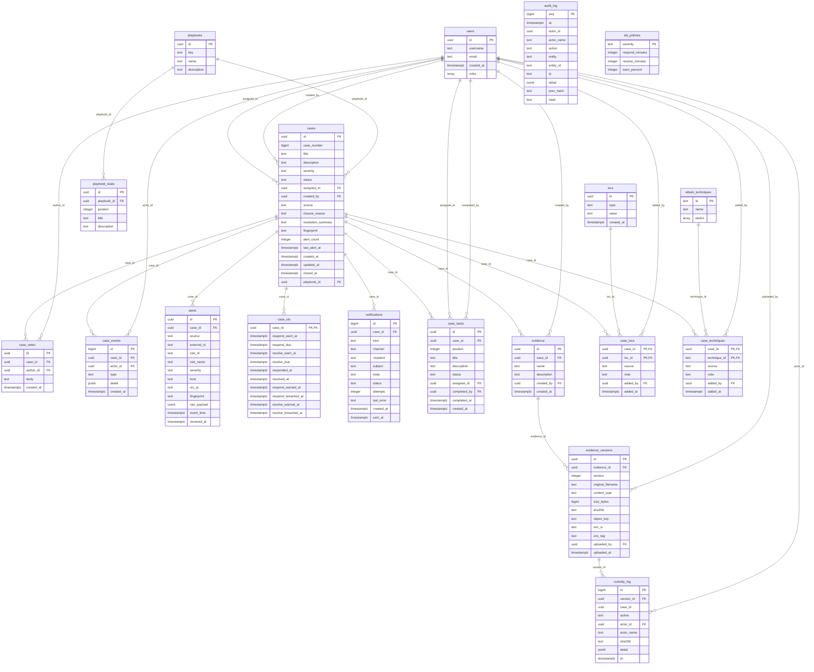

# Data model

_Generated by `backend/scripts/generate-docs.ts` from the code and the live database. Do not edit by hand: change the code, then run the script again._

19 tables, created by the SQL files in `backend/migrations`. The diagram shows keys only for readability; a data dictionary follows.

## Data dictionary

### alerts

Every SIEM alert received, linked to its case, with the untouched raw payload.

| Column | Type | Null | Key | Default |
|---|---|---|---|---|
| `id` | uuid | no | PK | `gen_random_uuid()` |
| `case_id` | uuid | no | FK |  |
| `source` | text | no |  |  |
| `external_id` | text | yes |  |  |
| `rule_id` | text | yes |  |  |
| `rule_name` | text | yes |  |  |
| `severity` | text | no |  |  |
| `host` | text | yes |  |  |
| `src_ip` | text | yes |  |  |
| `fingerprint` | text | no |  |  |
| `raw_payload` | jsonb | no |  |  |
| `event_time` | timestamp with time zone | yes |  |  |
| `received_at` | timestamp with time zone | no |  | `now()` |

### attack_techniques

MITRE ATT&CK technique catalog (starter set, importable in full).

| Column | Type | Null | Key | Default |
|---|---|---|---|---|
| `id` | text | no | PK |  |
| `name` | text | no |  |  |
| `tactics` | ARRAY | no |  | `'{}'::text[]` |

### audit_log

Append-only, hash-chained record of requests and system events (no foreign keys, so it outlives anything else).

| Column | Type | Null | Key | Default |
|---|---|---|---|---|
| `seq` | bigint | no | PK |  |
| `at` | timestamp with time zone | no |  |  |
| `actor_id` | uuid | yes |  |  |
| `actor_name` | text | no |  |  |
| `action` | text | no |  |  |
| `entity` | text | yes |  |  |
| `entity_id` | text | yes |  |  |
| `ip` | text | yes |  |  |
| `detail` | jsonb | no |  | `'{}'::jsonb` |
| `prev_hash` | text | no |  |  |
| `hash` | text | no |  |  |

### case_events

Case timeline: every create, status change, assignment, tag, evidence and SLA event.

| Column | Type | Null | Key | Default |
|---|---|---|---|---|
| `id` | bigint | no | PK |  |
| `case_id` | uuid | no | FK |  |
| `actor_id` | uuid | yes | FK |  |
| `type` | text | no |  |  |
| `detail` | jsonb | no |  | `'{}'::jsonb` |
| `created_at` | timestamp with time zone | no |  | `now()` |

### case_iocs

Which indicators are on which case, and whether they came from a person or the SIEM.

| Column | Type | Null | Key | Default |
|---|---|---|---|---|
| `case_id` | uuid | no | PK, FK |  |
| `ioc_id` | uuid | no | PK, FK |  |
| `source` | text | no |  | `'manual'::text` |
| `note` | text | no |  | `''::text` |
| `added_by` | uuid | yes | FK |  |
| `added_at` | timestamp with time zone | no |  | `now()` |

### case_notes

Investigation notes written by analysts.

| Column | Type | Null | Key | Default |
|---|---|---|---|---|
| `id` | uuid | no | PK | `gen_random_uuid()` |
| `case_id` | uuid | no | FK |  |
| `author_id` | uuid | yes | FK |  |
| `body` | text | no |  |  |
| `created_at` | timestamp with time zone | no |  | `now()` |

### case_sla

Per-case deadlines and the moments they were met, warned or breached.

| Column | Type | Null | Key | Default |
|---|---|---|---|---|
| `case_id` | uuid | no | PK, FK |  |
| `respond_warn_at` | timestamp with time zone | no |  |  |
| `respond_due` | timestamp with time zone | no |  |  |
| `resolve_warn_at` | timestamp with time zone | no |  |  |
| `resolve_due` | timestamp with time zone | no |  |  |
| `responded_at` | timestamp with time zone | yes |  |  |
| `resolved_at` | timestamp with time zone | yes |  |  |
| `respond_warned_at` | timestamp with time zone | yes |  |  |
| `respond_breached_at` | timestamp with time zone | yes |  |  |
| `resolve_warned_at` | timestamp with time zone | yes |  |  |
| `resolve_breached_at` | timestamp with time zone | yes |  |  |

### case_tasks

The checklist instance of a case, with status, assignee and completion data.

| Column | Type | Null | Key | Default |
|---|---|---|---|---|
| `id` | uuid | no | PK | `gen_random_uuid()` |
| `case_id` | uuid | no | FK |  |
| `position` | integer | no |  |  |
| `title` | text | no |  |  |
| `description` | text | no |  | `''::text` |
| `status` | text | no |  | `'todo'::text` |
| `assignee_id` | uuid | yes | FK |  |
| `completed_by` | uuid | yes | FK |  |
| `completed_at` | timestamp with time zone | yes |  |  |
| `created_at` | timestamp with time zone | no |  | `now()` |

### case_techniques

Which techniques are tagged on which case.

| Column | Type | Null | Key | Default |
|---|---|---|---|---|
| `case_id` | uuid | no | PK, FK |  |
| `technique_id` | text | no | PK, FK |  |
| `source` | text | no |  | `'manual'::text` |
| `note` | text | no |  | `''::text` |
| `added_by` | uuid | yes | FK |  |
| `added_at` | timestamp with time zone | no |  | `now()` |

### cases

The central record: title, severity, status, owner, closure data, SIEM fingerprint and alert counter.

| Column | Type | Null | Key | Default |
|---|---|---|---|---|
| `id` | uuid | no | PK | `gen_random_uuid()` |
| `case_number` | bigint | no |  |  |
| `title` | text | no |  |  |
| `description` | text | no |  | `''::text` |
| `severity` | text | no |  |  |
| `status` | text | no |  | `'new'::text` |
| `assigned_to` | uuid | yes | FK |  |
| `created_by` | uuid | yes | FK |  |
| `source` | text | no |  | `'manual'::text` |
| `closure_reason` | text | yes |  |  |
| `resolution_summary` | text | yes |  |  |
| `fingerprint` | text | yes |  |  |
| `alert_count` | integer | no |  | `0` |
| `last_alert_at` | timestamp with time zone | yes |  |  |
| `created_at` | timestamp with time zone | no |  | `now()` |
| `updated_at` | timestamp with time zone | no |  | `now()` |
| `closed_at` | timestamp with time zone | yes |  |  |
| `playbook_id` | uuid | yes | FK |  |

### custody_log

Immutable chain of custody: uploaded, downloaded, verified, verify_failed.

| Column | Type | Null | Key | Default |
|---|---|---|---|---|
| `id` | bigint | no | PK |  |
| `version_id` | uuid | no | FK |  |
| `case_id` | uuid | no |  |  |
| `action` | text | no |  |  |
| `actor_id` | uuid | yes | FK |  |
| `actor_name` | text | no |  |  |
| `sha256` | text | no |  |  |
| `detail` | jsonb | no |  | `'{}'::jsonb` |
| `at` | timestamp with time zone | no |  | `now()` |

### evidence

An evidence item of a case (unique name per case).

| Column | Type | Null | Key | Default |
|---|---|---|---|---|
| `id` | uuid | no | PK | `gen_random_uuid()` |
| `case_id` | uuid | no | FK |  |
| `name` | text | no |  |  |
| `description` | text | no |  | `''::text` |
| `created_by` | uuid | yes | FK |  |
| `created_at` | timestamp with time zone | no |  | `now()` |

### evidence_versions

Immutable versions: SHA-256, size, storage key, encryption IV and tag.

| Column | Type | Null | Key | Default |
|---|---|---|---|---|
| `id` | uuid | no | PK | `gen_random_uuid()` |
| `evidence_id` | uuid | no | FK |  |
| `version` | integer | no |  |  |
| `original_filename` | text | no |  |  |
| `content_type` | text | no |  |  |
| `size_bytes` | bigint | no |  |  |
| `sha256` | text | no |  |  |
| `object_key` | text | no |  |  |
| `enc_iv` | text | no |  |  |
| `enc_tag` | text | no |  |  |
| `uploaded_by` | uuid | yes | FK |  |
| `uploaded_at` | timestamp with time zone | no |  | `now()` |

### iocs

Deduplicated indicators of compromise (type and normalised value).

| Column | Type | Null | Key | Default |
|---|---|---|---|---|
| `id` | uuid | no | PK | `gen_random_uuid()` |
| `type` | text | no |  |  |
| `value` | text | no |  |  |
| `created_at` | timestamp with time zone | no |  | `now()` |

### notifications

Outbox of emails and Slack messages with delivery status and retry count.

| Column | Type | Null | Key | Default |
|---|---|---|---|---|
| `id` | bigint | no | PK |  |
| `case_id` | uuid | yes | FK |  |
| `kind` | text | no |  |  |
| `channel` | text | no |  |  |
| `recipient` | text | no |  |  |
| `subject` | text | no |  |  |
| `body` | text | no |  |  |
| `status` | text | no |  | `'pending'::text` |
| `attempts` | integer | no |  | `0` |
| `last_error` | text | yes |  |  |
| `created_at` | timestamp with time zone | no |  | `now()` |
| `sent_at` | timestamp with time zone | yes |  |  |

### playbook_tasks

The checklist steps of each playbook.

| Column | Type | Null | Key | Default |
|---|---|---|---|---|
| `id` | uuid | no | PK | `gen_random_uuid()` |
| `playbook_id` | uuid | no | FK |  |
| `position` | integer | no |  |  |
| `title` | text | no |  |  |
| `description` | text | no |  | `''::text` |

### playbooks

Case templates (phishing, malware, brute force, data exfiltration).

| Column | Type | Null | Key | Default |
|---|---|---|---|---|
| `id` | uuid | no | PK | `gen_random_uuid()` |
| `key` | text | no |  |  |
| `name` | text | no |  |  |
| `description` | text | no |  | `''::text` |

### sla_policies

Response and resolution times per severity, and the warning percentage.

| Column | Type | Null | Key | Default |
|---|---|---|---|---|
| `severity` | text | no | PK |  |
| `respond_minutes` | integer | no |  |  |
| `resolve_minutes` | integer | no |  |  |
| `warn_percent` | integer | no |  | `80` |

### users

Every Keycloak user who has called the API (id = Keycloak subject), with roles; used for ownership and notifications.

| Column | Type | Null | Key | Default |
|---|---|---|---|---|
| `id` | uuid | no | PK |  |
| `username` | text | no |  |  |
| `email` | text | yes |  |  |
| `created_at` | timestamp with time zone | no |  | `now()` |
| `roles` | ARRAY | no |  | `'{}'::text[]` |
