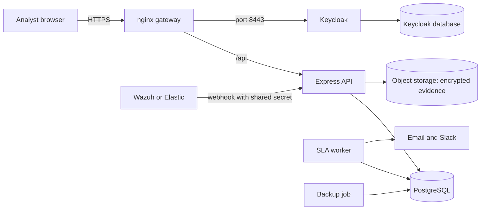
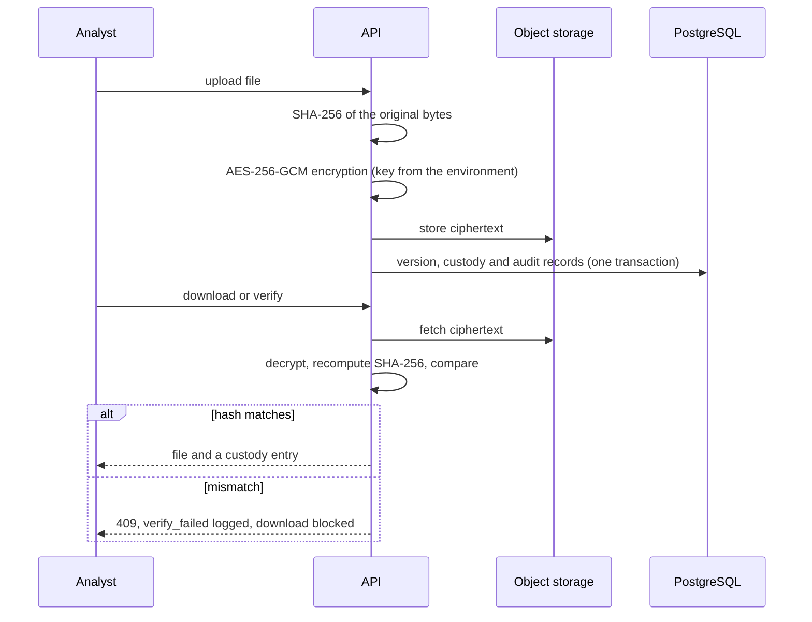

# Design notes

## 1. Architecture

| Component | Technology | Role |
|---|---|---|
| Web UI | React, TypeScript, Vite, keycloak-js (PKCE) | Case list and detail, evidence, tagging, dashboard, audit panel |
| Gateway | nginx | TLS 1.2/1.3, static UI, proxy for /api and /webhooks, Keycloak on 8443, security headers, request limiting |
| API | Node 24, Express 5, TypeScript, zod | Authentication, role checks, state machine, validation, audit |
| Worker | same image as the API | SLA timers every 10 s, notification delivery |
| Identity | Keycloak 26 | OIDC login, roles, TOTP MFA, brute-force lockout |
| Database | PostgreSQL 17 | Cases, tasks, alerts, evidence metadata, SLA state, audit chain |
| Evidence storage | RustFS (S3-compatible) | Encrypted evidence objects |
| Mail | Mailpit (lab) | Catches SLA emails; any SMTP server can replace it |
| Backup | postgres:17 container | Daily dump, 14 days kept |

## 2. Technology choices that differ from the brief

| Brief suggests | Used | Reason |
|---|---|---|
| FastAPI or Django REST | Express and TypeScript | One language for API, worker and UI; matches the team's skills |
| MinIO | RustFS behind an `ObjectStore` interface | The MinIO community edition is no longer distributed as a free container image and its repository is archived; the S3 API is unchanged, so only the storage service differs |
| Celery and Redis | Worker that polls PostgreSQL | No extra service; timers are database rows that survive restarts; `FOR UPDATE SKIP LOCKED` stops two workers handling the same case. Trade-off: up to 10 s polling delay |
| WeasyPrint or ReportLab | PDFKit | Pure Node, no Python or browser needed |
| Bandit | npm audit, gitleaks, OWASP ZAP | Bandit analyses Python only |

## 3. Request pipeline
1. nginx terminates TLS, applies a per-client request limit and forwards to the API.
2. The API applies rate limiting, then the audit middleware (which records the finished request, including denied and anonymous ones).
3. `authenticate` verifies the Keycloak JWT (RS256 keys fetched from Keycloak, issuer and expiry checked) and reads the roles.
4. The route declares its audit action, then `requirePermission` checks the role. Everything not allowed is a 403.
5. The handler validates the input with zod (unknown fields are dropped), then calls a service.
6. The service opens a transaction, locks the case row, applies the state machine, writes the change, the timeline event and, where relevant, the audit record, and commits.

## 4. Case lifecycle and SLA
States and transitions: see state-machine.md. A route cannot be added without an audit declaration (the field is required by the TypeScript type).

| Severity | Respond within | Resolve within |
|---|---|---|
| critical | 15 min | 4 h |
| high | 30 min | 8 h |
| medium | 2 h | 24 h |
| low | 8 h | 72 h |

- Both timers start at case creation. Changing the severity recalculates the deadlines from the creation time.
- Respond is met when the case first leaves `new`; resolve is met at `resolved` or `closed`.
- A warning is sent once at 80% of each time. A breach is recorded once.
- On a breach, a case in `new`, `triage` or `in_progress` is escalated automatically through a transition that no role can use (`system:escalate`). In other states the breach is recorded and notified only.
- The worker notifies the case owner and all SOC managers by email (and by Slack if configured). Messages go through an outbox table with up to five delivery attempts.
- Limitation: a reopened case keeps its first resolve time.

## 5. SIEM integration
- Endpoint: `POST /webhooks/alerts/{wazuh|elastic|generic}`, protected by a shared secret (`X-Webhook-Token`, compared in constant time), 1 MB body limit, 600 requests per minute.
- Each source is normalised to one format. Wazuh levels map to severity: 12 and above critical, 10 and above high, 7 and above medium, otherwise low. Elastic uses its severity or risk score (74, 48 and 22 are the thresholds).
- Fingerprint: SHA-256 of source, rule, host and source IP.
- Rules: (1) the same source and alert id is a duplicate and ignored; (2) the same fingerprint on a case that is not resolved or closed and was last alerted within 60 minutes is merged, and a higher severity raises the case; (3) otherwise a new case is created.
- An advisory lock per fingerprint serialises concurrent alerts, so ten simultaneous alerts produce one case (tested).
- New cases get SLA timers, a playbook chosen from the rule name (phishing, malware, data exfiltration, brute force), the source IP as an indicator and the rule's ATT&CK ids as techniques.

## 6. Evidence vault

- A new upload with the same name in a case becomes the next version. Versions and custody rows cannot be updated or deleted (database triggers).
- Encryption: AES-256-GCM, a random IV per file, and the object key as authenticated data, so a ciphertext copied to another record fails to decrypt. The key lives in an environment variable and must be backed up separately from the data.
- Limits: 25 MB per file; files are held in memory while hashed and encrypted. Names are sanitised and files are always served as downloads with a generic content type.

## 7. Audit log
- Each record holds time, actor, action, entity, IP and details, plus `prev_hash` and `hash`, where hash = SHA-256 of the previous hash and the canonical JSON of the record.
- Appends are serialised by a database advisory lock, so the chain cannot fork. Triggers reject UPDATE, DELETE and TRUNCATE.
- Recorded: every API request (including denied and anonymous ones), SIEM ingestion, SLA breaches, all evidence actions, tag removals and report exports. Evidence, SIEM and SLA entries are written in the same transaction as the change. Repeated views are recorded at most once a minute per user and case, so the 5-second UI polling does not flood the log.
- `GET /api/audit/verify` walks the chain and names the first broken record. A saved head hash (the "anchor") also detects removal of the newest records.
- Honest limits: the table owner can disable the triggers (the chain still reveals any edit); request-level entries are written just after the response; tail truncation needs the anchor.

## 8. Indicators, ATT&CK and metrics
- Indicator types: IP, domain, URL, email and MD5, SHA-1 and SHA-256 hashes. Input is cleaned of defanging (`hxxp`, `[.]`) and normalised before storage. A domain search also finds its subdomains; an IP search is exact; other searches are substring matches. Each indicator shows how many other cases contain it.
- ATT&CK: a starter catalog of about 70 techniques with an importer for the full MITRE catalog; unknown ids are rejected.
- Metrics: MTTD is the time from the SIEM event to case creation (SIEM cases only; it cannot see when the attack began). MTTA is creation to first analyst action. MTTR is creation to resolved or closed. SLA compliance is met divided by met plus missed. Backlog is cases not yet resolved or closed. Workload is per assignee. Time zone: UTC.

## 9. Security controls
TLS at the gateway; JWT validation with issuer, expiry and signature checks; deny-by-default RBAC; parameterised SQL and validated input; escaped output in the UI; CSP and other security headers; no-store caching on API responses; CORS limited to one origin; rate limits; brute-force lockout in Keycloak; encrypted evidence; hash-chained audit log; secrets only in environment variables. Results of the scans: security-test-report.md.

## 10. Known limitations
Polling instead of WebSockets; self-signed certificate; the SIEM webhook port is published for the lab; direct-access grants and development passwords in the lab realm; no token audience check; the audit table owner can disable its triggers; MTTD measures detection-to-case time only; starter ATT&CK catalog; stretch goals not built.