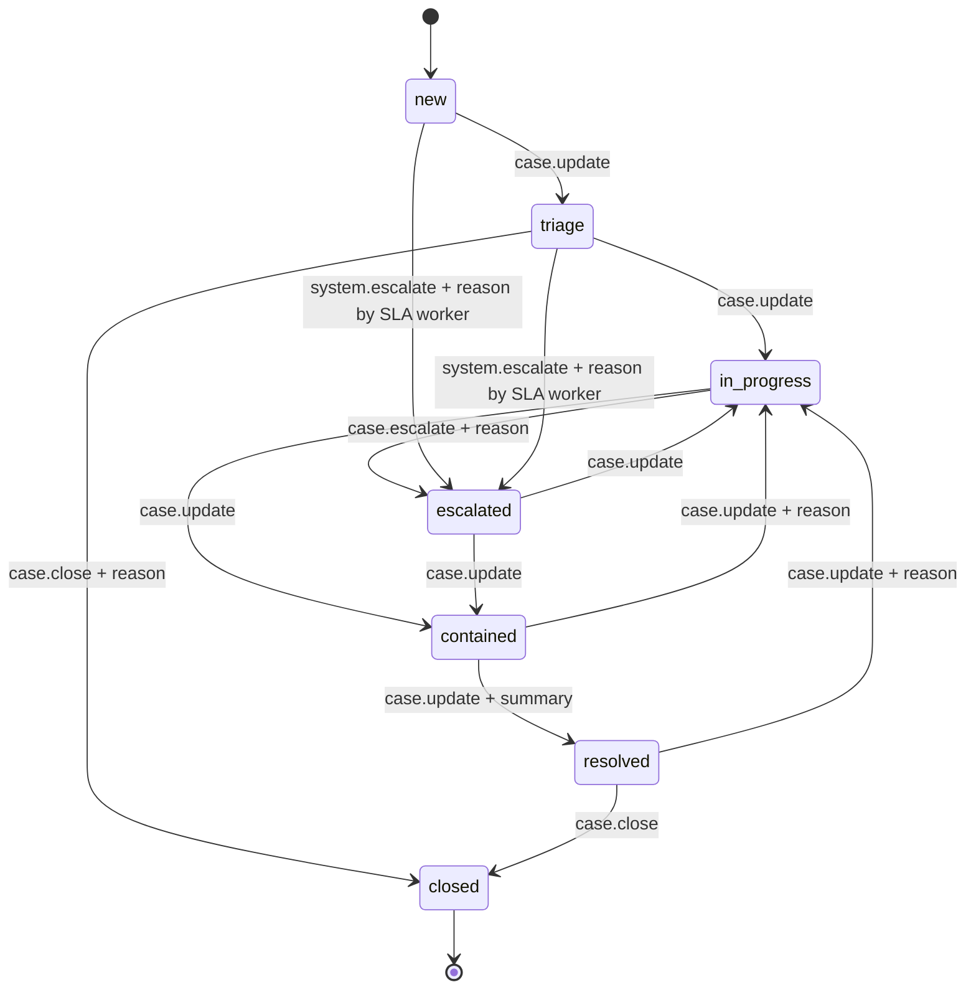

# Case lifecycle (state machine)

_Generated by `backend/scripts/generate-docs.ts` from the code and the live database. Do not edit by hand: change the code, then run the script again._

The backend enforces this table (`src/cases/stateMachine.ts`). A transition that is not listed is rejected with HTTP 409.

## Allowed transitions

| From | To | Permission needed | Who may do it | Extra input required |
|---|---|---|---|---|
| new | triage | `case:update` | Tier 1 analyst, Tier 2 analyst, Incident responder, SOC manager | - |
| triage | in_progress | `case:update` | Tier 1 analyst, Tier 2 analyst, Incident responder, SOC manager | - |
| triage | closed | `case:close` | Incident responder, SOC manager | reason |
| in_progress | escalated | `case:escalate` | Tier 1 analyst, Tier 2 analyst, SOC manager | reason |
| in_progress | contained | `case:update` | Tier 1 analyst, Tier 2 analyst, Incident responder, SOC manager | - |
| escalated | in_progress | `case:update` | Tier 1 analyst, Tier 2 analyst, Incident responder, SOC manager | - |
| escalated | contained | `case:update` | Tier 1 analyst, Tier 2 analyst, Incident responder, SOC manager | - |
| contained | resolved | `case:update` | Tier 1 analyst, Tier 2 analyst, Incident responder, SOC manager | summary |
| contained | in_progress | `case:update` | Tier 1 analyst, Tier 2 analyst, Incident responder, SOC manager | reason |
| resolved | closed | `case:close` | Incident responder, SOC manager | - |
| resolved | in_progress | `case:update` | Tier 1 analyst, Tier 2 analyst, Incident responder, SOC manager | reason |
| new | escalated | `system:escalate` | system only (SLA worker) | reason |
| triage | escalated | `system:escalate` | system only (SLA worker) | reason |

Rules that the table does not show:

- `closed` is terminal.
- Moving `new` to `triage` assigns the case to the user who triaged it, if it had no owner.
- A case cannot be resolved while playbook tasks are still `todo` or `in_progress` (skipped tasks count as finished).
- Every transition writes a timeline event in the same database transaction, and the request is recorded in the audit log.
